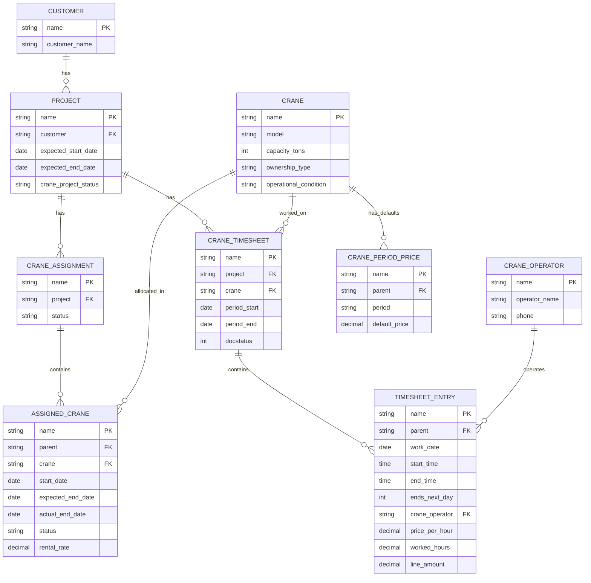

# Crane Rental Management — Approved Requirements & Codex Implementation Plan

**Purpose:** Implement the features described in the user's six-page `Cranes.pdf`, incorporating ONLY the modifications explicitly approved in the follow-up discussion. This document **supersedes conflicting portions** of `CODEX_CRANE_RENTAL_SPEC.md`, especially the old Project statuses, Timesheet cardinality, assignment lifecycle, and crane availability design.

**For Codex:** First inspect the existing Frappe/ERPNext app, schema, hooks, versions, migrations, and tests. Implement in the **existing app and bench**, reusing existing fields/DocTypes. Do not create another app, and do not drop/rename existing data without a safe migration and explicit approval. Treat this as an executable development specification, not a request for another architecture proposal.

## 0. Scope, provenance, and approved decisions

The original handwritten document (`Cranes.pdf`) establishes:

- **Page 1:** Customer → Project → Crane Assignment → Assigned Crane; Project → Crane Timesheet → Timesheet Entry; Crane and Crane Operator link into the appropriate records. `Assigned Crane` and `Timesheet Entry` are child tables.
- **Page 2:** Project lifecycle: **Draft → Reserved → In Progress → Complete**, with **Draft → In Progress** directly allowed; Reserve, Start, and Complete actions. Project should display a read-only overview of all assigned cranes and their status. The notes allow starting by start date **or** manually.
- **Pages 3–4:** Crane Assignment batches, future reservations, and bulk **Complete** and **Cancel** dialogs where users choose individual cranes and relevant dates. Cancelled means the crane did not participate in the project.
- **Page 5:** Crane availability, future reservation Gantt view, and a fixed Day/Month/Year price table.
- **Page 6:** **One Crane Timesheet = one crane**; implement a **new submittable Crane Timesheet**, not standard ERPNext Timesheet. Time entries capture working intervals, hourly price, and operator(s).

Approved follow-up changes (these take precedence where they differ from the handwritten pages):

1. **Keep the user's Project lifecycle exactly**; do not replace it with a recommended alternative lifecycle.
2. **Compute Crane Assignment parent status from its child cranes**, not simply copy the Project status. Child cranes can be complete while the assignment and Project are still in progress.
3. **Differentiate Complete from Cancel**, preserve assignment history and actual end dates; a crane with recorded work must not be cancelled as though it never worked.
4. **Redesign availability**: distinguish current activity from future reservations; derive availability from effective date ranges and prevent overlapping assignments; provide a future-reservations Gantt/timeline.
5. **One Timesheet per crane**. Keep operators in child rows, handle cross-midnight shifts and overlapping operators without double-counting crane billable hours.

**Out of scope until explicitly requested:** introducing a `Crane Rental Order` DocType, changing to an alternative Project workflow, replacing the native Project wholesale, generating invoices, payroll, complex day/month/year billing contracts, and building an unrelated ERP app. A Project may have multiple commercial agreements, but **this task does not add an agreement DocType**. Leave room for a future optional agreement reference.

---

## 1. Required ERD — updated



**Frappe implementation note:** `Assigned Crane`, `Timesheet Entry`, and `Crane Period Price` are `istable = 1` child DocTypes. Their `parent`, `parenttype`, `parentfield`, `idx`, and `name` are Frappe-managed metadata — do **not** add separate Link fields named `parent`. Standard Links target parent/master DocTypes, not individual child-table rows. For timesheet-to-allocation validation, query the Project → Crane Assignment → Assigned Crane path using `project`, `crane`, and dates.

### Main roles

| DocType | Nature | Responsibility |
|---|---|---|
| `Customer` | Native ERPNext | Client record |
| `Project` | Prefer native ERPNext; extend safely | Construction/project lifecycle; project-level crane overview |
| `Crane` | Existing or custom master | Physical crane, specs and maintenance/administrative condition |
| `Crane Operator` | Existing or custom master | Operator identity; multiple operators may work the same crane |
| `Crane Assignment` | Custom, **not submittable** | A batch containing 1–100+ crane allocations for one Project |
| `Assigned Crane` | Child table of Crane Assignment | One crane and one assignment period with its own status and dates |
| `Crane Timesheet` | Custom, **submittable** | Working report for **exactly one crane** in one Project/period |
| `Timesheet Entry` | Child table of Crane Timesheet | One operator working one time interval |
| `Crane Period Price` | Child table of Crane | Default rates for fixed Day/Month/Year periods |

---

## 2. Project — **preserve user's lifecycle** (PDF p. 2)

The business workflow has **exactly these four normal statuses**, using those visible labels:

```
Draft ──Reserve──▶ Reserved ──Start──▶ In Progress ──Complete──▶ Complete
  └─────────────────Start────────────────▶ In Progress
```

- **Draft:** initial state on Save; cranes need not already be reserved.
- **Reserved:** Reservation action; selected assignment rows hold future/expected crane periods. Reservation means the crane is booked for specific dates, not necessarily operating today.
- **In Progress:** Start action; must be possible directly from **Draft**, as explicitly drawn in the PDF. Starting a Project **does not imply every crane is currently working**.
- **Complete:** Complete action; new assignment additions/reservations and new operational work must be blocked. Do not auto-complete the Project merely because one assignment, or even all current assignments, are complete; Project completion is its own action.

**Start by date OR manually:** The handwritten PDF explicitly allows either behavior. Provide a manual **Start** action and an optional, explicitly configurable date-triggered start using a scheduled job when enabled. Document the setting and default chosen; never silently change Project status just because a date passed unless automatic start was enabled. Both paths use the same transition validations. Do not substitute a different workflow.

**Project/ERPNext compatibility:** If standard ERPNext `Project.status` cannot support these four choices without breaking ERPNext, use a custom `crane_project_status` field and project action methods. Preserve the native ERPNext status semantics. If the existing app already implements the approved choices safely, reuse them; do not introduce duplicate status fields.

**Project assigned cranes overview:** Show a **read-only derived view** of all related `Assigned Crane` rows, including crane, assignment batch, planned start/end, actual end and per-crane status. The handwritten notes call this a "read-only child table": implement it as a read-only dashboard/HTML/report or safely synchronized read-only view, **not a second writable source of assignment truth**. Filter across all batches attached to that Project.

**Constraints:** Permission-check every workflow action. A completed Project cannot receive new or extended crane allocations. Historical approved timesheets remain viewable; any necessary correction needs controlled cancellation/amendment or an authorized procedure, not silent editing.

---

## 3. Crane Assignment — batch document and child rows (PDF pp. 1, 3–4)

### Parent: `Crane Assignment`

- Fields: `project` (required Link to Project), `status` (read-only/automatically calculated), `assigned_cranes` (Table → Assigned Crane).
- **Non-submittable** (`is_submittable = 0`). One batch can hold **100+ cranes**; a Project may have several batches.
- Do not maintain an independent, manually editable parent status. Recalculate on every update to child rows, including bulk actions, in server-side logic.
- Parent status vocabulary: **Draft, Reserved, In Progress, Complete, Cancelled**. `Cancelled` is used when all rows were cancelled; `Complete` when all rows are terminal and at least one completed. This is independent of the Project's status.

### Child: `Assigned Crane` (istable)

| Fieldname | Type | Rule |
|---|---|---|
| `crane` | Link → Crane | Required |
| `start_date` | Date | Required; first reserved/assigned day |
| `expected_end_date` | Date | Required; original planned completion; **do not overwrite** on early completion |
| `actual_end_date` | Date | Empty until completed/released, or set on eligible cancellation |
| `status` | Select | `Draft`, `Reserved`, `In Progress`, `Complete`, `Cancelled` |
| `rental_rate` | Currency | Optional contractual rate snapshot (not interchangeable with hourly price) |
| `cancellation_reason` | Small Text | Required when a row is cancelled |

Date validation: `start_date <= expected_end_date`. On normal early completion `start_date <= actual_end_date <= expected_end_date`; if late completion is a legitimate business case, permit it with a documented exception and continued overlap validation, not silent truncation. Never erase historical rows on Complete/Cancel.

### Independent child lifecycle

- Child rows may be Draft or Reserved while the Project is Draft/Reserved; future reservations remain Reserved even when the Project has started.
- A row that starts participating can be In Progress; that row may be Complete while **other rows remain In Progress**.
- Completing the row records its actual completion/release date; this shortens its **effective allocation interval** without changing the original expected date.
- Cancelling means **did not participate**. Allow cancellation of a Draft/Reserved row, or a nominally In Progress row **only if there is no actual work/approved timesheet**; require a reason and the date of cancellation. If actual work exists, reject Cancel and require Complete/early release instead. Do not delete history.
- An operator cannot use bulk completion/cancellation to bypass Project permissions or date checks.

### Automatically derive parent status (server side)

Calculate using ALL child rows, not Project.status. Suggested deterministic precedence:

1. No rows, or all rows Draft → `Draft`.
2. All rows Cancelled → `Cancelled`.
3. Every row terminal (`Complete` or `Cancelled`) and at least one Complete → `Complete`.
4. Any row `In Progress`, or a mix of completed rows and still-pending rows → `In Progress`.
5. Otherwise any `Reserved` rows → `Reserved`.
6. Otherwise → `Draft`.

Implement this in one reusable Python method used by `validate` and all bulk operations. A parent can be `In Progress` with one completed crane and nine still active, as agreed. When the last outstanding row becomes terminal, automatically mark the parent Complete/Cancelled according to the rule above. Do not rely solely on client JS to compute these states.

### Bulk **Complete** action (PDF p. 4)

- Add `Actions → Complete Cranes` button to the parent form.
- Open a Frappe dialog listing eligible **In Progress** child rows with checkboxes, crane IDs/names and current expected end dates.
- User selects 1, 2 or 100 cranes and chooses an **actual completion date** (allow per-row dates if useful).
- Server checks selected row IDs belong to this assignment, are eligible, dates valid, no relevant work after the proposed completion date, and available permissions.
- Change **only selected rows** to `Complete`; set `actual_end_date`; retain expected end date. Recalculate parent status and new availability. Use atomic server-side operation and avoid partial updates on failures.

### Bulk **Cancel** action (PDF p. 4, with approved safety restriction)

- Add `Actions → Cancel Cranes` button with dialog listing eligible Draft/Reserved/In Progress rows.
- User selects rows, supplies cancellation date and **required reason**.
- Server rejects cancellation for any crane allocation that has recorded/approved actual work, even if current status says In Progress. Show useful error and suggest completing/releasing it instead.
- Set child `status = Cancelled`, store date and reason, retain row for audit. Recalculate parent and crane availability.

### Safety

- Changes to child rows **must not** silently rewrite or remove allocations referenced by submitted timesheets. Block unsafe historical changes and deletion, with an actionable message.
- On new or changed reserved/active periods, prevent overlapping allocation to another active Project (see availability section). Validate on server, including imports/API operations.
- If one crane has several non-overlapping periods, keep separate child rows rather than overwriting a previous one.

---

## 4. Crane availability and future reservations (PDF p. 5 + approved redesign)

Do **not** use a single mutually-exclusive Crane status (`Idle` vs `In Progress` vs `Reserved`) to represent both current work and future bookings. A crane can be **working today** while also **reserved for another Project next month**.

### Separate concerns

- **Physical/administrative condition:** e.g. `Operational`, `Maintenance`, `Inactive` (field on Crane; do not accidentally overwrite existing master values without migration).
- **Activity for a chosen date:** `Working / Reserved / Idle` (computed based on Project and child-row participation for that day).
- **Future reservations:** zero or multiple future allocation intervals, displayed independently as a calendar/Gantt timeline.
- **Available on date?** calculated boolean + explanation; optionally show `next_available_date`.

### Date-range rules

- Each non-cancelled allocation reserves a date range starting at `start_date` and normally ending at `expected_end_date`.
- If completed early, the effective allocation ends at `actual_end_date` **inclusive**, not the original expected end; this allows the crane to be assigned to a new Project **the following day**. If same-day handover is required later, model times, not only dates.
- Cancelled rows do not block future bookings; preserve their original dates for historical reporting.
- Draft rows are provisional and do not block availability until reserved/activated.
- Detect **inclusive interval overlap**, including across **different assignment batches/projects** and future reservations. Example: `[Oct 01, Oct 18]` and `[Oct 18, Oct 30]` conflict; a new interval starting `Oct 19` is permitted.
- Prevent same-crane conflicting active/reserved allocations to different Projects (and normally within the same Project too unless a justified explicit policy exists). Maintenance/Inactive also blocks assignments unless an authorized exception is explicitly designed; do not allow accidental double-booking.
- Availability may change due to Project status, row reservation/activation/completion/cancellation, date changes, and maintenance. Do **not** make stored Crane.status the sole source of truth.
- Provide a **Gantt/timeline view** showing crane vs reservation/assignment interval and linked Project, with distinct colors/labels for Reserved, In Progress, Complete, Cancelled as appropriate. For a large fleet, include useful filters (dates, crane, Project and status).

### Performance and concurrency

- Keep date-range availability checks efficient for 100+ cranes/batch. Avoid one N+1 query per row if possible.
- Availability validation must happen during the authoritative server write, not solely when selecting cranes in JS. Handle concurrent overlapping booking requests safely (transaction/locking or equivalent approach compatible with the existing Frappe deployment).

---

## 5. Crane default prices (PDF p. 5)

The `Crane` master must show a child table (e.g. `period_prices` → `Crane Period Price`) with exactly these **three default entries**, visible before initial Save:

| Period | Price |
|---|---:|
| `Day` | Editable default |
| `Month` | Editable default |
| `Year` | Editable default |

- Automatically populate once for a new Crane record, client-side **before Save** for immediate visibility, with Python validation/defaulting so API-created records are also correct.
- Prevent duplicate periods; do not erase manually-entered prices on refresh or on edits. Keep period labels fixed; let users edit prices.
- Validate nonnegative prices. These values are **reference/default rates**, not immutable rental contract amounts. A price agreed for an assignment should be stored as a snapshot there or in a future rental agreement.
- **Do not infer an hourly rental rate by dividing a Day/Month/Year default.** Timesheet hourly rate is distinct unless an explicit commercial rule is later approved.

---

## 6. Crane Timesheet — one crane per document, submittable (PDF p. 6)

**Critical correction to the old Codex spec:** The old spec permitted multiple cranes in a single Timesheet. The handwritten requirements expressly say **`1 Timesheet = 1 Crane`**. Implement exactly that.

### Parent: `Crane Timesheet` (new custom DocType)

| Fieldname | Type | Rule |
|---|---|---|
| `project` | Link → Project | Required |
| `crane` | Link → Crane | Required, **ONE crane per Timesheet** |
| `period_start` | Date | Required |
| `period_end` | Date | Required; `>= period_start` |
| `timesheet_entries` | Table → Timesheet Entry | Rows for this crane and period |
| `total_operator_hours` | Float, read-only | Sum of row/operator worked hours |
| `total_crane_billable_hours` | Float, read-only | Duration of unique (non-overlapping) crane work intervals |
| `total_amount` | Currency, read-only | Calculated from billable time and approved hourly rate(s) |
| `docstatus` | Frappe built-in | **Submittable**: Draft 0, Submitted 1, Cancelled 2 |

- **Create a new `Crane Timesheet`; do NOT modify/use native ERPNext `Timesheet`.** `is_submittable = 1`.
- Do not create a separate manually editable status duplicating `docstatus` unless already needed in the app; map Draft/Submitted/Cancelled using standard Frappe lifecycle.
- Optional attachment for the scanned/signed source sheet. Support project and crane filtering in list views and show Timesheets on the Project dashboard.
- Keep the crane link **on the header only**, not on `Timesheet Entry` rows. One timesheet can contain multiple drivers/shift rows, all working that same header crane.
- On Submit, check required rows, all dates, rates, and assignment coverage. Submitted timesheets are immutable except via authorized Cancel/Amend as supported in Frappe.

### Child: `Timesheet Entry` (istable)

| Fieldname | Type | Rule |
|---|---|---|
| `work_date` | Date | Required; start date of shift/interval |
| `start_time` | Time | Required |
| `end_time` | Time | Required |
| `ends_next_day` | Check | Marks overnight work crossing midnight |
| `crane_operator` | Link → Crane Operator | Required; many operators per Timesheet/date allowed |
| `price_per_hour` | Currency | Hourly price, as on the handwritten sheet; nonnegative; explicit value or commercial default |
| `worked_hours` | Float, read-only | Calculate real duration of this operator's interval |
| `line_amount` | Currency, read-only | Informational amount; cannot blindly be summed for overlapping intervals |

**Formula:** `operator_worked_hours = end_datetime − start_datetime` in hours; `line_amount = operator_worked_hours × price_per_hour` for that row's informational/operator calculation. For the **crane's billable total**, use the **union of time intervals**, not the sum of simultaneous operator time. Do not double-charge when two operators overlap on one crane.

- Compute timestamps from `work_date` + `start_time` + `end_time`, using `ends_next_day` to cross midnight; reject zero/negative/implausibly long shifts and invalid end ordering rather than silently guessing overnight.
- Validate **both calendar dates touched by overnight work** lie within the permitted assignment window and Timesheet period, or require explicit documented handling; do not accept a shift extending past actual crane release.
- Example: Driver A 08:00–12:00 and Driver B 10:00–14:00 yields 4 + 4 = **8 operator-hours** but only **6 crane billable hours**. If rates differ over overlapping segments, **do not silently choose a rate or double-charge**: reject the ambiguous pricing or require an explicitly documented billing rule before submission.
- Avoid double-billing identical crane work intervals across **multiple submitted timesheets** for the same crane/project/period; detect duplicates/overlaps as relevant. Legitimate multiple operators on the same time period are allowed within one Timesheet.
- A submitted historical Timesheet remains valid after its crane row later changes to Complete, as long as the recorded work falls on/before `actual_end_date`. Do not require an allocation to be *currently In Progress* in order to accept a legitimate historical timesheet.

### Required assignment validation

At save/submit, verify that the **header crane** is allocated to the **header Project** in an eligible assignment batch covering every working interval. Query child allocations through Project and Crane Assignment. Do not make a Link field to individual `Assigned Crane` child records. Reject unassigned cranes, work after completion/release, wrong Project, and work before the assignment start. If Project is Complete, reject **new work occurring after completion** while preserving existing approved historical data.

---

## 7. Relationship and workflow integrity checks

Implement authoritative **Python** validation (not only form JavaScript) and apply it to normal Save, bulk dialog APIs, background jobs, and imports.

1. User has appropriate permission to manipulate Project lifecycle, Crane Assignment or Timesheet.
2. A child Crane row belongs to the requested assignment and that assignment belongs to the expected Project; no ID injection/cross-project updates.
3. Start/end intervals are valid; requested completion date cannot precede start or precede recorded submitted work; preserve original expected date.
4. A crane is not double-booked for overlapping active/reserved periods, across all assignment batches and projects.
5. Cannot Cancel a crane that has actual work. Require user-facing error explaining why to use Complete instead.
6. Cannot delete or rewrite an allocation in a way that invalidates submitted Timesheets. Keep an audit trail of who completed/cancelled it and when (Frappe versioning or explicit audit fields).
7. Cancelled allocations do not generate new operational timesheets; Completed allocations are eligible for **historical** work only through the actual end date.
8. Project Complete blocks new allocations and new operational dates, but does not overwrite historical submissions.
9. `Crane Assignment.status` is derived from children after every change and never blindly mirrors `Project.crane_project_status`.
10. Timesheet interval and operator-hours validation runs server-side, including overnight intervals and overlapping operator reporting.
11. No negative rates/hours. Show clear errors including Project, assignment, child row index, crane and offending date/time.
12. Prevent accidental duplicate/missing fixed crane price periods.
13. Use proper permission checks + transaction safety for bulk Complete/Cancel (no half-updated document on failure).

---

## 8. Frappe UI/features to build

### Project Form
- Approved workflow action buttons: **Reserve**, **Start**, **Complete** (where valid); direct Draft → In Progress supported.
- Read-only aggregated list of assigned cranes and each child's state, pulled from Crane Assignments (not editable duplicate rows).
- Links/dashboard to Crane Assignments and Crane Timesheets.

### Crane Assignment Form
- A child grid supporting **100+ cranes**, one record per batch rather than per crane.
- Parent status field read-only, automatically computed; each child row shows `crane`, start, expected end, actual end, status, rental rate.
- **Complete Cranes** dialog listing eligible rows with multi-select and completion date.
- **Cancel Cranes** dialog with multi-select, cancellation date and reason; clearly explain no-work restriction.
- After actions, reload/recalculate parent and Project dashboard; never use client-only state as source of truth.

### Crane Form / Availability
- Default Day/Month/Year price rows visible immediately on a new Crane document.
- Current activity, future reservation indicator and chosen-date availability computed separately.
- Future reservation **Gantt / timeline** including Project and assignment intervals with filters.

### Crane Timesheet Form
- Project + **one Crane** in header; dates; optional original-paper attachment.
- Timesheet Entries: date, start time, end time, overnight flag, operator, price/hour, calculated worked hours.
- Totals: operator hours, deduplicated crane hours, provisional amount; Submit/Cancel/Amend follows Frappe `docstatus`.

---

## 9. Example acceptance scenarios

### A. Project lifecycle (user's original)

1. Create Project → **Draft**.
2. Click Reserve → **Reserved**.
3. Click Start → **In Progress**.
4. Click Complete → **Complete**, new allocations blocked.
5. Separately, create another Project and click Start straight from **Draft** → **In Progress**, with no mandatory Reserve step.
6. If auto-start configured on, scheduled job follows the same authorization/business checks; if off, start stays manual.

### B. Ten cranes, two finish early

- Project PRJ-001, Assignment ASG-001, 10 crane rows planned Oct 1–30.
- On Oct 18, use **Complete Cranes** dialog to select CR-001 + CR-002 and actual end Oct 18.
- Only these two rows become **Complete**, retaining expected end Oct 30.
- Remaining eight rows stay **In Progress** (or Reserved if their future start is not reached).
- **Parent ASG-001 remains In Progress.** The Project remains In Progress until its own action.
- CR-001 and CR-002 become available for an assignment beginning Oct 19, absent other reservations/maintenance; booking on Oct 18 still conflicts.
- After all ten rows become terminal, parent status becomes Complete (assuming at least one actually completed).

### C. Cancel vs complete

- A reserved crane that never worked may be Cancelled using dialog + reason/date.
- A crane with a submitted Timesheet recording 8h of work **cannot** be Cancelled as never participated; it must be Completed/released with actual end date.
- Nothing is deleted from historical assignment records.

### D. One crane per Timesheet, two drivers

- TS-001: Project PRJ-001, Crane CR-003, period Oct 1–7.
- Entries: Oct 2 Driver A 08:00–12:00 price/hour 100; Oct 2 Driver B 10:00–14:00 price/hour 100.
- Operator total = 8h; crane billable total = **6h**; amount = **600**, not 800.
- A second crane CR-004 **must have another Crane Timesheet**, not another crane field inside these child entries.
- Reject a row before CR-003's assignment start or after its actual end/release. Historical entry within its earlier interval remains legitimate even after assignment is completed.

### E. Availability / reservations

- Crane CR-005 is active on Project A Oct 1–18 and reserved for Project B Nov 1–30: show current work **and** future reservation; do not flatten into a single status.
- Attempt to reserve CR-005 for Project C Oct 15–22 → reject overlapping booking.
- Attempt to reserve Oct 19–31 → allow (assuming no other conditions block it).
- Gantt displays the Project A and B intervals.

### F. Default prices

- Create a Crane: before saving, its price table shows **Day / Month / Year** exactly once with editable prices.
- Refresh/new Save does not erase price edits or append duplicates.
- An hourly Timesheet does not infer its rate from Day/Month/Year prices.

---

## 10. Delivery phases and automated tests

Implement in this order, adapting to existing code rather than rewriting it:

1. **Audit current app**: read DocType JSON/controllers/client JS/hooks, custom fields and existing workflow. Report mismatches before destructive change.
2. **Schema + safe migrations**: Project status customization, Assigned Crane date/status fields, Crane Period Price table, Timesheet crane moved to header, overnight time fields; migration must preserve existing data.
3. **Python services/controllers**: project transitions, derived parent status, bulk Complete/Cancel, date-overlap/availability, timesheet duration/validation/totals.
4. **UI**: buttons/dialogs, Project read-only overview, crane price table initialization, availability/Gantt, Timesheet totals.
5. **Tests**: meaningful integration/unit cases for all acceptance scenarios A–F plus permissions, overlapping intervals across batches, cross-midnight, concurrency, immutable submitted timesheets, mass 100-crane batch and draft/terminal status edges.
6. **Document & verify**: run appropriate test commands/bench migrate in safe environment; give changed file list, migration steps, manual test instructions, known assumptions and any intentionally deferred items.

### Existing data / migrations

- The *old* design put `crane` inside `Timesheet Entry`, allowing multiple cranes per document. **Do not just drop this field.** If any existing Timesheet has entries for multiple cranes, split data safely into one-timesheet-per-crane or stop and request an approved migration approach. Preserve submitted records and linkage.
- If native ERPNext Project is in use, extend via custom fields/fixtures/property setters/hooks only where compatible; don't overwrite ERPNext core DocType JSON, and don't disturb unrelated projects.
- Reuse existing Crane/Operator/Assignment fields when compatible; use explicit mapping and migration when fieldnames differ.
- Keep all app metadata and customizations deployable/version controlled; do not rely on manual site-only patches.

---

## 11. Non-negotiable guardrails for Codex

1. **Keep the user's four Project statuses and transitions** (`Draft`, `Reserved`, `In Progress`, `Complete`; direct Draft → In Progress) — don't replace them with another lifecycle.
2. `Crane Assignment` parent is **one batch, many cranes**, with **automatic independent status**.
3. Per-crane **Complete** is not the same as **Cancel**; preserve expected vs actual end date and historical work.
4. A crane's **current work** and **future bookings** are separate; validate date ranges server-side and show a future reservations timeline.
5. **Exactly one crane per Crane Timesheet**; Timesheet is custom and submittable; multiple operators belong in its child table.
6. Only the specified child tables are `istable`, and never create ordinary Links to individual child row IDs.
7. Do not introduce `Crane Rental Order`, Sales Order accounting or billing workflow in this task.
8. Do not destroy or silently rewrite existing business records. For an unresolved existing-schema conflict, stop and explain the concrete issue with a proposed non-destructive migration.
9. Keep server-side business rules authoritative and add tests. The client dialog is just an interface, not an alternative validation path.

**Definition of done:** An administrator can create a Project with the user's exact lifecycle, reserve/assign 100 cranes in one Assignment, independently complete or cancel selected cranes safely, see the parent status recalculate, view conflict-free reservation timelines, maintain Day/Month/Year default crane prices, and submit one-crane Timesheets with multiple operators and correct non-double-counted worked/billable hours.
