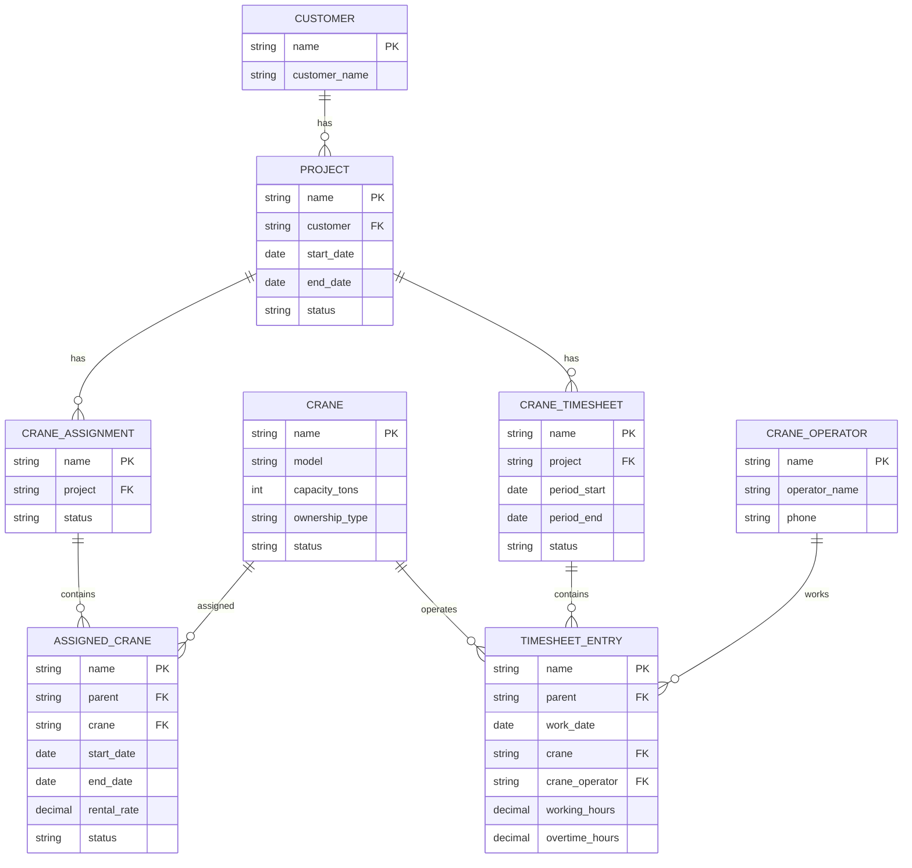

# Crane Rental Management — Frappe App Implementation Spec

## 1. Goal

Implement the **crane-rental operations module** in the existing Frappe application using the schema below. A project may rent **100+ cranes**, and staff must be able to assign all of them through **one Crane Assignment document with a child table**, not by manually creating one document per crane.

Each project can receive many Crane Timesheets. **Each timesheet can contain multiple cranes and multiple operators**, with one child-table row per crane/operator/date entry. The same crane may have more than one operator on the same day.

**Scope of this task:** implement the DocTypes, their relationships, useful form behavior, server-side validation, and minimal tests. Do **not** build invoicing, quotations, Sales Orders, payroll, or complex pricing logic yet.

## 2. Existing application and naming precautions

1. **Inspect the current repository, Frappe/ERPNext version, app module, installed DocTypes, and conventions before changing anything.** Implement the schema in the existing app; do not create a new app/bench/site unless explicitly asked.
2. **Customer:** reuse ERPNext's built-in `Customer` DocType if ERPNext is installed. Do not create another Customer DocType.
3. **Project:** reuse the built-in ERPNext `Project` DocType when it exists, and extend it via supported custom fields where needed. **Do not create a second DocType named `Project`** or overwrite core JSON. If ERPNext is not installed or the existing `Project` has an incompatible meaning, stop and report the conflict before making a new project model.
4. **Timesheet:** `Crane Timesheet` is a custom DocType; do not change ERPNext's built-in `Timesheet`.
5. Use existing DocTypes for operators (`Employee`, for example) **only if the repository already uses that convention and it meets this specification**. Otherwise create `Crane Operator` as shown.
6. Use exact existing fieldnames when suitable; if adapting names to existing schema, document the mappings.

## 3. ERD (agreed design)

**Cardinality:** all eight displayed relationships are one-to-many (`1 → 0..N`). A crane and a project are related *indirectly* through assignment rows. No standalone Crane Assignment document is needed for each crane.

## 4. DocTypes and fields

The table below specifies functional fields. Frappe's framework-managed fields (`name`, `owner`, `creation`, `modified`, `parent`, `parenttype`, `parentfield`, `idx`, etc.) should **not** be manually recreated in Child DocTypes. Follow the repository's naming-series conventions for standalone records.

### 4.1 `Crane` — standalone DocType

| Fieldname | Frappe type | Requirement |
|---|---|---|
| `crane_name` (or a suitable existing title field) | Data | Required, human-readable label |
| `model` | Data | Optional |
| `capacity_tons` | Int | Optional; >= 0 |
| `ownership_type` | Select | `Owned`, `Rented`, `Other` |
| `status` | Select | `Available`, `Assigned`, `Maintenance`, `Inactive` |

A crane is a master record and can appear in many `Assigned Crane` rows **over time**.

### 4.2 `Crane Operator` — standalone DocType

| Fieldname | Frappe type | Requirement |
|---|---|---|
| `operator_name` | Data | Required; use as display/title |
| `phone` | Data | Optional |

One operator may appear in many timesheet rows; do **not** force one operator per crane or per day.

### 4.3 `Project` — reuse/extend existing ERPNext DocType

Required business concepts (use native fields where available):

| Concept | Type | Requirement |
|---|---|---|
| Project identity | Native project `name` / naming | Framework-managed |
| `customer` | Link → `Customer` | Required for this workflow |
| Project start/end | Date | Start <= end when both set |
| Operational status | Select or workflow field | `Draft`, `Confirmed`, `In Progress`, `Completed`, `Closed`, `Cancelled` |

**Important:** ERPNext Project may already have fields and status semantics. Prefer a dedicated custom field such as `crane_rental_status` instead of replacing ERPNext's standard status if choices differ. Use project start/end native fields where sensible. Implement the new choices without breaking unrelated standard ERPNext processes.

A **Project currently represents the customer's rental job/order** (not necessarily a geographic site). Do not introduce a separate `Rental Order` in this phase.

### 4.4 `Crane Assignment` — standalone **parent** DocType

| Fieldname | Frappe type | Requirement |
|---|---|---|
| `project` | Link → `Project` | Required |
| `status` | Select | `Draft`, `Confirmed`, `In Progress`, `Completed`, `Cancelled` |
| `assigned_cranes` | Table → `Assigned Crane` | Required child table (one or more rows for confirmed/active assignment) |

**One Crane Assignment = one assignment *batch* for a project**, not one crane. Users can put 100+ cranes into `assigned_cranes`. A project can have multiple assignment batches (e.g., later additions).

### 4.5 `Assigned Crane` — **Child Table DocType** (`istable = 1`)

| Fieldname | Frappe type | Requirement |
|---|---|---|
| `crane` | Link → `Crane` | Required |
| `start_date` | Date | Required |
| `end_date` | Date | Required, >= start_date |
| `rental_rate` | Currency | Optional in MVP; >= 0 |
| `status` | Select | `Reserved`, `Working`, `Completed`, `Cancelled` |

Do **not** create a manual `parent` Link field: Frappe manages the relationship to its parent `Crane Assignment`. The child row identifies **one crane + one period + one rental rate**, so the same crane can have multiple non-overlapping periods when appropriate. Do not enforce global uniqueness on `crane`.

### 4.6 `Crane Timesheet` — standalone **parent** DocType

| Fieldname | Frappe type | Requirement |
|---|---|---|
| `project` | Link → `Project` | Required |
| `period_start` | Date | Required |
| `period_end` | Date | Required, >= period_start |
| `status` | Select | `Draft`, `Reviewed`, `Approved`, `Cancelled` |
| `timesheet_entries` | Table → `Timesheet Entry` | Child rows |

**Do not add a mandatory single `crane` or `crane_assignment` field on the Timesheet header.** A single document must be able to record **different cranes** and operators for one project and reporting period.

Optional quality-of-life field: an attachment to the scanned/signed original site timesheet, if the repository's UI conventions call for it.

### 4.7 `Timesheet Entry` — **Child Table DocType** (`istable = 1`)

| Fieldname | Frappe type | Requirement |
|---|---|---|
| `work_date` | Date | Required; inside parent period |
| `crane` | Link → `Crane` | Required |
| `crane_operator` | Link → `Crane Operator` | Required |
| `working_hours` | Float | Required, >= 0 |
| `overtime_hours` | Float | Optional, defaults 0, >= 0 |

Each row records **one crane + one operator + one date + working/overtime hours**. Allow two operators on the same crane on the same date (two rows), and allow the same operator to work on different cranes as long as the entry data is valid.

Again, Frappe automatically owns `parent`, `parenttype`, and `parentfield` for child rows.

## 5. Relationship implementation details

| Parent / source | Child / destination | Cardinality | How to implement in Frappe |
|---|---|---|---|
| `Customer` | `Project` | 1:N | `Project.customer` Link → `Customer` |
| `Project` | `Crane Assignment` | 1:N | `Crane Assignment.project` Link → `Project` |
| `Crane Assignment` | `Assigned Crane` | 1:N | `Crane Assignment.assigned_cranes` Table → `Assigned Crane` |
| `Crane` | `Assigned Crane` | 1:N | `Assigned Crane.crane` Link → `Crane` |
| `Project` | `Crane Timesheet` | 1:N | `Crane Timesheet.project` Link → `Project` |
| `Crane Timesheet` | `Timesheet Entry` | 1:N | `Crane Timesheet.timesheet_entries` Table → `Timesheet Entry` |
| `Crane` | `Timesheet Entry` | 1:N | `Timesheet Entry.crane` Link → `Crane` |
| `Crane Operator` | `Timesheet Entry` | 1:N | `Timesheet Entry.crane_operator` Link → `Crane Operator` |

**Critical Frappe caveat:** Child-table rows are not ordinary standalone Link targets. Do **not** implement `Crane Timesheet → Assigned Crane` via a normal Link field pointed at a child row. Instead, enforce the linkage **logically** using `project`, `crane`, and `work_date` on the server, by checking the project's assignment child rows.

## 6. Required server-side validations

Implement checks in Python DocType controllers and/or standard Frappe hooks, not just Client Script, so API/import writes are also checked.

1. All start dates must be <= their respective end dates. Timesheet entry `work_date` must lie inside `[period_start, period_end]` (inclusive).
2. Hours and rates cannot be negative. Allow zero hours when recording a non-working day if intended; do not silently generate such rows.
3. A Timesheet entry's `crane` must exist in a **non-cancelled** `Assigned Crane` row within a **non-cancelled** `Crane Assignment` linked to the **same project**, and `work_date` must be within that row's `[start_date, end_date]` (inclusive). Prefer only eligible/confirmed assignments according to the final status workflow. Define which statuses are eligible in one maintainable place.
4. Ensure a crane cannot be assigned to **different active projects for overlapping dates** unless an explicit business override policy is added later. Draft/cancelled assignments should not block allocation. Consider the project's batches and date ranges; don't treat the same crane as globally unavailable forever.
5. If the project has dates, assignment and timesheet dates should fall within them **or produce a clearly handled, documented exception** (extensions can happen); do not quietly truncate dates.
6. Validate required child rows when confirming/approving records, while allowing a truly empty Draft if that is the chosen UX.
7. Do not constrain `Crane Operator` to a single project or crane. Do not enforce uniqueness on `(crane, work_date)` because multiple operators may work that crane that day.
8. Give actionable validation errors identifying the offending child row number, crane, and date.

## 7. Form/UI behavior (MVP)

- In `Crane Assignment`, display `project`, `status`, and an editable **Assigned Cranes** grid. Add columns for crane, dates, rate, status. It must support bulk data entry for 100+ rows without creating 100 parent documents.
- In `Crane Timesheet`, display `project`, `period_start`, `period_end`, `status`, and an editable **Timesheet Entries** grid showing date, crane, operator, normal hours, overtime hours.
- Link field options should show meaningful names (crane title/operator name) in addition to IDs, using Frappe title/search-field configuration; avoid replacing stable IDs with display names.
- Optionally filter the `crane` Link picker in timesheet rows to cranes assigned to the selected project for the chosen date. **This is UX only; the authoritative check is server-side.**
- Make it easy to view related Crane Assignments and Crane Timesheets from the project (standard Frappe dashboard/links). Do not embed full Timesheet documents directly into the Project child table.

## 8. Example / acceptance scenario

Project `PRJ-001` is for Customer `ABC Construction`.

A user creates **one** Crane Assignment `ASG-001` with 3 rows:

| Crane | Start | End | Rate |
|---|---|---|---|
| `CR-001` | 2026-10-01 | 2026-10-31 | 5000 |
| `CR-002` | 2026-10-01 | 2026-11-30 | 6000 |
| `CR-003` | 2026-10-05 | 2026-12-31 | 7000 |

In production, the same form may have **100+ rows**.

A user creates **one** Crane Timesheet `TS-001` for `PRJ-001`, covering `2026-10-01` to `2026-10-07`, with these rows:

| Work date | Crane | Operator | Working hours | Overtime |
|---|---|---|---:|---:|
| 2026-10-01 | `CR-001` | Ahmed | 8 | 0 |
| 2026-10-02 | `CR-001` | Mohamed | 10 | 2 |
| 2026-10-05 | `CR-003` | Ahmed | 6 | 0 |
| 2026-10-05 | `CR-003` | Mohamed | 4 | 0 |

These entries must be allowed. Trying to add `CR-003` on `2026-10-01` must be rejected (not assigned until Oct 5). Trying to record a crane that isn't assigned to `PRJ-001` must also be rejected.

## 9. Deliverables / definition of done

1. Create/extend all DocTypes using **version-controlled app code/fixtures/migrations** appropriate for the existing Frappe repository. Avoid changes that only exist through a local UI customization and can't be deployed.
2. Correctly designate **only `Assigned Crane` and `Timesheet Entry` as Child Table DocTypes**. Make their Table fields available on their respective parents.
3. Wire all relationships and server-side validations above; ensure a timesheet supports many cranes/operators.
4. Add concise automated tests for valid 100-crane assignments, multiple operators on one crane/day, out-of-range dates, unassigned cranes, overlapping active assignments, and negative hours.
5. Explain the files changed, how to migrate/install into an existing site, how to open the forms, and any assumptions/field mappings made for existing ERPNext DocTypes.
6. Do not remove or modify existing unrelated DocTypes/data. Ask before destructive schema or data migrations.

## 10. Not in scope yet

Quotations, Sales Order items, invoicing, billing rates per hour vs day vs month, equipment maintenance, driver payroll, subcontractor payments, pricing rules, and automatic generation of one row per calendar day. These can be designed as separate features after the operational schema works.
