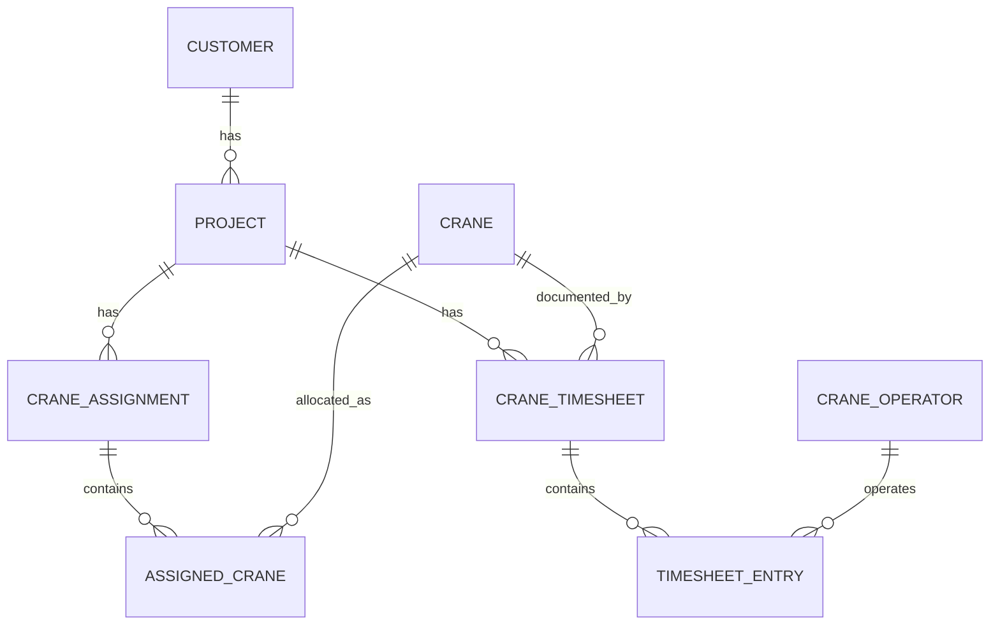

# Codex Task — Simplify the Existing Frappe Crane Rental App

> **This is a LOCAL DEVELOPMENT refactor, not a production deployment.**
> Update the **existing app/codebase in place**. **NO legacy-data migrations, conversion patches, backups, rollback plans, or backward-compatibility layers** are required. Existing local test records may be recreated as needed, but **do not silently wipe the site or database**. Ask before any destructive reset.

## 1. Objective and decisions (source of truth)

The previous design repeated `Draft`, `Reserved`, `In Progress`, and `Complete` at Project, Crane Assignment, and individual-crane levels. It created unnecessary status synchronization and time-based transitions. **Remove that complexity.**

The system has only three independent business concerns:

1. **Project lifecycle:** Is the overall customer Project still open or finished?
2. **Crane reservation/assignment:** Have we **agreed to send this specific crane** to this Project for specified dates, and has that commitment ended?
3. **Actual crane work:** When did it actually work, for how many hours, and with which operators? **Timesheets** record that, not a `Working` status.

**Exact definition:** `Reserved` means **we have agreed to send the crane to the Project**. It does **not** mean the crane has arrived at the site or started operating.

This document supersedes older Codex instructions that synchronized Project status with Crane Assignment/Assigned Crane status, used a scheduled job to change rows to `In Progress`, or required Project `Reserve` / `Start` actions.

## 2. Inspect the app, then refactor what is already there

Before editing, inspect existing code and identify the real DocType names, modules and fields, including:

- Native ERPNext `Project` and any custom Project status/workflow/hooks.
- `Crane Assignment` (parent) and `Assigned Crane` (child).
- `Crane`, `Crane Operator`, `Crane Timesheet`, `Timesheet Entry`.
- Controllers, DocType JSON, client scripts, buttons/dialogs, hooks, scheduled jobs, reports, permission conditions and tests.
- Existing calculation of the Crane Assignment completion bar and date-aware availability.

**Do not create a new app, Project DocType, Crane Rental Order, Rental Agreement DocType, or additional intermediary tables.** Reuse the current schema when sensible. Do not edit ERPNext/Frappe core files. Keep code and DocType metadata tracked in the existing app.

**Do not generate data migration scripts.** Because the system is local/in development, update code, JSON, field options, and tests directly. If obsolete test data contains statuses no longer supported, point it out and explain how to recreate that local test data rather than writing compatibility/mapping code.

## 3. FINAL status model — only store what is necessary

| Record | Stored status | Control | Business meaning |
|---|---|---|---|
| **Project** | `Open`, `Completed`, `Cancelled` | User action / native ERPNext behavior | Overall project remains open, is finished, or is cancelled |
| **Crane Assignment** (parent) | **NO status field needed** | None | A batch/container for many crane allocations; show counts and a progress bar |
| **Assigned Crane** (child row) | `Draft`, `Reserved`, `Released`, `Cancelled` | Validated user actions | Proposed → committed → released, or cancelled without work |
| **Crane Timesheet** | Native `docstatus`: Draft `0`, Submitted `1`, Cancelled `2` | Frappe Submit/Cancel | The record of actual crane work |
| **Crane master** | Physical condition only, if currently present | Separate master controls | Not another copy of the project's or reservation's status |

The native ERPNext `Project` should be reused. Prefer its standard `Open` / `Completed` / `Cancelled` lifecycle. If the app added a separate four-stage custom Crane Project workflow, remove/retire that customization and its automation; do not break ERPNext's unrelated native behavior.

**No `In Progress` status is stored on any Assigned Crane row.** A Reserved crane can work for a week, have submitted Timesheets, and remain `Reserved` until an explicit `Release` action.

**No global Project `Reserved` status or `Reserve Project` button.** Reservations happen at the **individual Assigned Crane** level, including a bulk Reserve button on the Assignment form.

## 4. Required relationships (keep the existing model)



- **One Crane Assignment record can contain 100+ cranes** through the `Assigned Crane` child table. One Project can have many Assignment batches.
- **One Crane Timesheet = ONE crane**, linked to one Project, with many operator/time rows in `Timesheet Entry`.
- `Assigned Crane` and `Timesheet Entry` remain Frappe Child DocTypes (`istable = 1`), managed via their parent Table fields.
- Do not create ordinary `Link` fields to child row IDs. Validate Timesheet eligibility by checking Project, Crane, and effective assignment dates server-side.
- A Project may have several commercial agreements over its lifetime, but **do not introduce a new agreement DocType for this task**.

## 5. Project — only the overall lifecycle

```text
           Complete Project
    Open ──────────────────▶ Completed
      └──── Cancel Project ─▶ Cancelled
```

**Rules:**

1. A new Project is `Open` (or use the existing native equivalent).
2. Remove custom `Reserve Project`, `Start Project`, status cascade functions, and any date-triggered workflow jobs for those statuses.
3. A Project stays `Open` while some cranes are Draft, some Reserved, some Released, and others Cancelled. **Never infer Project completion from crane count or today's date.**
4. Authorized users explicitly mark a Project `Completed`. Require no outstanding `Reserved` allocations and no unresolved Draft reservations that need a decision. Reject with a list of the affected cranes/assignment rows. Block completion if required Timesheet approvals remain outstanding.
5. `Cancelled` is for a Project called off. Require all outstanding commitments to be resolved first; do not treat already-performed work as though it never existed.
6. `Completed` and `Cancelled` Projects block new reservations and new work; any historical corrections use controlled authorized procedures (e.g., Timesheet cancellation/amendment).
7. Preserve a read-only Project crane overview aggregated from the Assignment child rows. **Don't duplicate assignment rows in a second editable Project table.**

## 6. Crane Assignment — no parent status, only operations and progress

`Crane Assignment` is **non-submittable**. Remove its custom `status` field from the UI/model when safe locally, as well as all calculations trying to derive that field from the Project or child rows.

Keep:

- `project` Link → Project.
- `assigned_cranes` Table → Assigned Crane.
- Existing batch-level identifiers/reference fields that remain useful.
- Bulk action buttons: **Reserve Selected**, **Release Selected**, **Cancel Selected**.
- Read-only counts of `Draft`, `Reserved`, `Released`, `Cancelled` child rows.
- Read-only **completion progress bar**, calculated from child rows, not another status.

**Progress calculation:**

```python
eligible_total = sum(row.status != "Cancelled" for row in assigned_cranes)
released_total = sum(row.status == "Released" for row in assigned_cranes)
completion_percent = round(100 * released_total / eligible_total, 1) if eligible_total else 0
```

- Cancelled rows count **neither** as completed nor in the denominator.
- Draft rows remain in the denominator until resolved.
- Example: 10 rows, 2 Cancelled, 3 Released → `3 / 8 = 37.5%`.
- Display `3 / 8 Released` alongside the bar; if no eligible rows, show `0%` and `No active crane allocations` instead of confusing `100%`.
- Recalculate on form load/refresh and after bulk actions, using a shared authoritative Python calculation. The UI may update optimistically but must display the server result after Save.

## 7. Assigned Crane — the *only* crane booking lifecycle

Each `Assigned Crane` row is one crane allocated to a Project (via its parent Assignment) for one period.

### Required fields

| Field | Meaning / validation |
|---|---|
| `crane` | Link to Crane (required) |
| `start_date` | Beginning of committed assignment period (required) |
| `expected_end_date` | Planned end; do **not** overwrite when released early |
| `actual_end_date` or `actual_release_date` | Date of actual release; initially empty |
| `status` | **Only** `Draft`, `Reserved`, `Released`, `Cancelled` |
| `cancellation_reason` | Required to cancel |
| `cancellation_date` | Recorded when cancelled |
| `rental_rate` | Keep existing agreed-rate field if present; separate from Timesheet hourly rate |

Reuse current field names where appropriate; avoid introducing duplicate end-date fields. Rename/remove old fields directly in local development only if they aren't needed by the agreed behavior.

### Allowed transitions

```text
Draft ──Reserve──▶ Reserved ──Release──▶ Released
  └──Cancel─────▶ Cancelled
Reserved ──Cancel (no actual work)────▶ Cancelled
```

- **Draft:** proposed booking, NOT counted as reserved, no availability lock.
- **Reserved:** agreed to send the crane; blocks other overlapping confirmed bookings; does not mean on-site or working.
- **Released:** commitment finished, whether on or before/after the original end date. Record actual end date; keep planned end and historical Timesheets.
- **Cancelled:** no actual work occurred and the proposed commitment was withdrawn. Require reason/date; keep row for traceability. If work exists, **use Release, not Cancel**.
- `Released` and `Cancelled` are terminal during normal use. Do not allow edits that falsify existing work.
- **No time-driven status updates.** Reaching the planned start date does not turn `Reserved` into `In Progress`; reaching the planned end date does not auto-release.

### Bulk action dialogs on Crane Assignment

**Reserve Selected:** select Draft rows; validate Project is Open, date ranges are valid, no other committed booking overlaps, and crane condition permits reservation; then change only selected rows to Reserved.

**Release Selected:** select Reserved rows, choose an actual release date (support per-row dates if practical), validate it does not precede start or any recorded work; change only selected rows to Released, preserve expected end date, refresh availability and progress.

**Cancel Selected:** select Draft/Reserved rows, supply cancellation reason and date; reject any row with actual work (including unsubmitted non-cancelled Timesheet entries); mark only selected rows Cancelled; preserve row and original dates.

All three actions must call server-side methods that check permissions and revalidate selected **child row IDs** against the current parent Project. Execute each bulk operation atomically (no partial updates on validation errors). Do not use direct client-only status changes to bypass validation.

### Date constraints

- `start_date <= expected_end_date`.
- `actual_release_date >= start_date`.
- An early release can precede `expected_end_date`; a late release can exceed it **only after conflict validation**.
- Effective allocation occupied dates: Reserved → `[start_date, expected_end_date]` pending release; Released → `[start_date, actual_release_date]`, both inclusive.
- Cannot release before a work interval already recorded for that allocation, or rewrite/delete a row that would invalidate a submitted Timesheet.

## 8. Availability — calculate from dates, not status synchronization

Do not store an exclusive `Idle / Reserved / In Progress` operational status on the Crane master. A crane can have work on the current Project and a separate future reservation.

The availability service must account for:

1. Reserved rows and their date ranges;
2. Released rows and the actual occupied date ranges (including historical overlap checking);
3. Maintenance/inactive/unavailable physical crane conditions;
4. Conflicting allocation periods in **every** Project and Crane Assignment batch;
5. An overdue reservation whose scheduled end has passed without an explicit release (flag for operator review instead of silently making the crane available).

Draft and Cancelled rows do not block availability. Dates overlap **inclusively**:

```python
overlap = start_a <= end_b and start_b <= end_a
```

Example: A crane released on Oct 18 is free for **Oct 19** onward, not Oct 18, assuming no other restrictions.

Provide derived UI indicators (NOT stored statuses): `Upcoming reservation`, `Reserved for selected date`, `Work recorded`, `Overdue / release confirmation needed`, `Available for selected dates`. A `Reserved` row with recorded Timesheets is still Reserved; Timesheets prove work.

Preserve/update the reservation calendar/Gantt if it exists. Prevent double-booking using server-side checks even for bulk, API, imports, and concurrent requests. Avoid N+1 queries for 100+ cranes.

## 9. Crane Timesheet — actual work only

**Keep the previously approved Timesheet model. Do not redesign it during this refactor.**

- Custom `Crane Timesheet`, **submittable** (`docstatus` Draft=0, Submitted=1, Cancelled=2).
- **Exactly one crane per Timesheet**. Put `project` and `crane` in the parent/header.
- `Timesheet Entry` child rows contain working date/interval, operator, hours, and relevant hourly rate; multiple operators can operate the same crane on the same date.
- Validate work against the same Project/crane and an eligible Reserved or Released allocation whose **effective period includes the actual work dates/times**.
- **Reserved is sufficient** for work recording; no `In Progress` booking status is required.
- A Timesheet may be entered retrospectively after release, provided actual work falls inside the historical allocation period and follows permissions/approval rules.
- Submitting or cancelling a Timesheet **does not change** Project or Assigned Crane statuses.
- Preserve working-hours calculations, overnight shift handling, prevention of overlapping double-charged crane hours, server-side validation, and Submitted document protections already built.

## 10. Remove redundant code — LOCAL DEVELOPMENT ONLY

Search for and remove/refactor:

- Project workflow statuses `Draft / Reserved / In Progress / Complete` **that were added specifically by this custom app**; replace with existing native-style `Open / Completed / Cancelled` behavior.
- Project `Reserve` and `Start` custom buttons and their server handlers.
- Any Project → Crane Assignment → Assigned Crane **status synchronization** calls.
- Crane Assignment parent `status` UI, auto-calculation, transitions and dependent permissions/reports.
- Assigned Crane `In Progress` and `Completed` old lifecycle labels; use `Reserved` for a committed booking and `Released` for an actual finish.
- Scheduler hooks/jobs or ad hoc fake-time logic that advance booking/project statuses based on current date.
- Any code that changes `Crane.status` to indicate its Project/Assignment status.
- Old duplicate status summaries, conflicting guards, and tests of removed states.

**Preserve** important operational behavior: bulk selection, booking date conflict checks, project overview, expected/actual end dates, early release, cancel safety, Timesheets, user permissions, the completion bar, and reservation calendar.

**No data migration scripts or legacy-state mapping needed.** The user is developing locally. If existing local records or fixtures use removed status values, report it and use fresh test fixtures or ask before resetting local data. Do not create temporary compatibility branches merely to support old dev records.

## 11. Acceptance tests Codex must implement/run

### A. Future booking

- Open Project P1 has 2 Draft cranes, booked for Nov 1–30.
- Reserve both → child rows Reserved, Project stays Open, parent has no status.
- Nov 1 arrives → no stored status is automatically changed.
- Actual work recorded during November is valid without setting In Progress.
- Overlapping booking of either crane on a different Project is rejected.

### B. Current work, partial early release

- Open Project P2; one Assignment has 10 Reserved cranes Oct 1–30.
- Release 2 on Oct 14 → only those 2 rows Released, actual end Oct 14, expected end remains Oct 30.
- Other 8 remain Reserved (with or without Timesheets).
- Progress = **2/10 = 20%**; Project remains Open.
- A new booking starting Oct 15 is allowed if the crane is otherwise available; Oct 14 still conflicts.

### C. Historical project

- Create an Open Project today with September crane bookings and real September Timesheets.
- Release cranes with actual September end dates, preserving planned dates.
- User marks Project Completed after commitments are resolved.
- No clock changes or synthetic old lifecycle transitions are required.

### D. Cancel vs release

- Cancel a Reserved crane with no work → Cancelled, reason/date recorded; future interval becomes unblocked.
- Cancel a Reserved crane with real work → reject with guidance to Release.
- Releasing cannot predate recorded work.

### E. Completion progress

- Assignment has 10 rows: 3 Released, 5 Reserved, 2 Cancelled → **3/8 = 37.5%**.
- All rows Cancelled → **0%**, with clear empty-denominator UI.
- No parent `status` stored or synced.

### F. Project closing

- Project with any Reserved crane cannot be Completed. Show blocking crane(s).
- After all reservations are Released/Cancelled and necessary Timesheets handled, Project may be marked Completed manually.
- Project does not complete automatically when last crane is Released.

### G. Timesheet behavior and concurrency

- One Timesheet can contain multiple operators **but only one crane**.
- Valid retrospective work is accepted against a Released assignment's actual dates.
- Invalid post-release work is rejected.
- Submitted Timesheets are protected and calculations don't double-charge overlapping operator intervals.
- 100+ crane rows can be processed; concurrent overlap attempts cannot double-book the same crane.

## 12. Deliverables

1. Briefly report what the **existing repository actually contains** (DocTypes, fields, hooks, status logic, controls) before changing it.
2. Refactor the **existing** app with the smallest coherent set of changes; no new App, no new Project, no new Rental Order, no replacement of core ERPNext logic.
3. Update DocType schemas, controllers, client scripts, hooks and tests to match this spec. Do not add data migration/legacy compatibility code.
4. Run applicable tests in the existing local environment and report what passed and what couldn't be run.
5. Provide an exact list of changed files and any open assumptions. If a test database reset would help, ask before doing it.

**Definition of done:** Project has one simple overall lifecycle; Crane Assignment is only a multi-crane container plus progress; each child crane has Draft/Reserved/Released/Cancelled; reservation means a **commitment to send**, not arrival or work; Timesheets independently record actual work; current/future availability is calculated from dates; and no automatic status mirroring remains.
