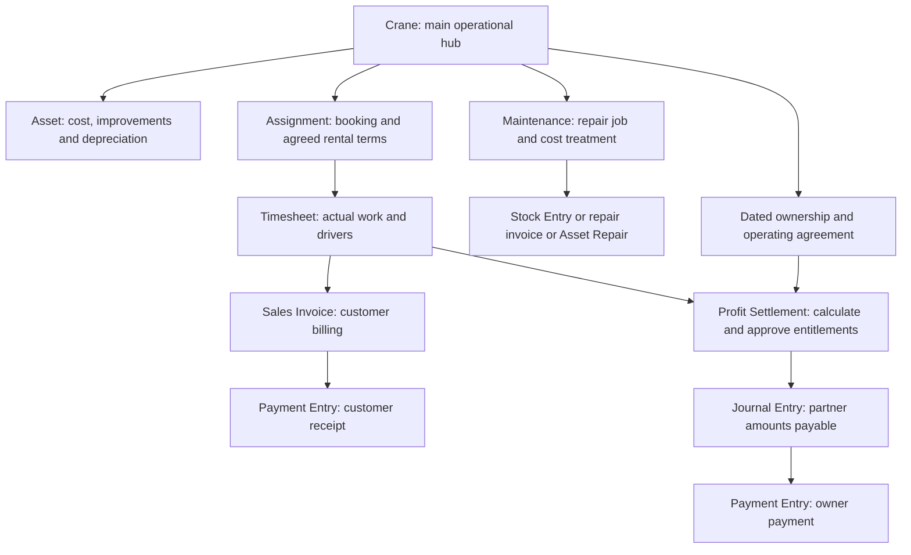
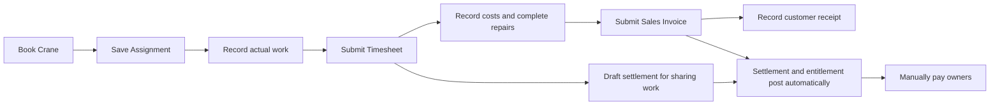
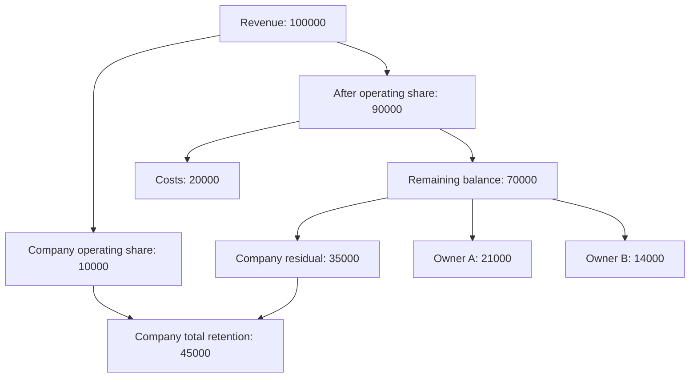
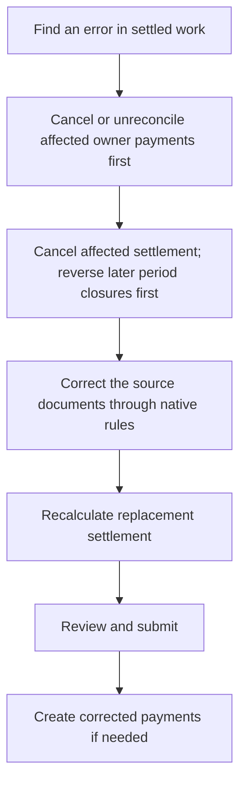

# Heavy Equipment Rental — user guide

## Fast maintenance entry

Choose **Quick Repair** for a cash/bank repair: enter Description, Cost and Payment Method, then Save and Submit. The repair expense account comes from HER Settings → Maintenance Defaults. Both actual dates default to today.

Choose **Use Stock Parts** to consume items already in your warehouse. Choose **Supplier Bill** to purchase parts and/or labour in one table. Submission posts the supplier invoice, consumes only stock parts and pays the entered amount (full by default; zero leaves it unpaid).

Expand **Advanced Accounting** for asset improvements, owner recovery, no-cost work, or **Use Existing Accounting Documents**. Quick Repair offers cash expense, owner recovery and no-cost treatment; use Stock Parts or Supplier Bill for automatic capitalization. Existing manual repairs retain their original workflow.

**Latest rule (2026-11-15):** Enable Profit Sharing and Hired from Supplier are mutually exclusive. Selecting either clears the other on the Crane form; server validation rejects both together. Both may remain off for ordinary company work. This supersedes earlier combined-hire/profit-sharing guidance. Existing agreements and posted documents are not rewritten.

**Operating Fees:** use the Crane table columns Our Company, Partner, Fee Basis and Operating Fee %. New cranes start with Our Company / Grand Total / 0%. Grand Total uses crane revenue before expenses; Net Profit uses positive revenue minus allocated expenses, before any fees. For revenue 10,000 and expenses 2,000, a 10% Grand Total fee is 1,000; a 10% Net Profit fee is 800. Multiple rows use the same original bases independently. Enable Profit Sharing to apply nonzero fees, and edit the terms and Save for revisions.

**Latest Crane setup:** enter owners and their ownership/profit percentages in Owners & Profit Shares. Ownership is calculated automatically. New cranes start with Our Company at 100%. Enable Profit Sharing when distributions or operating fees are required; enter Operating Fees rows (an external Shareholder need not own a share). Hired from Supplier independently enables supplier selection; purchase rates and units stay on Timesheets. Hired cranes may leave ownership unrecorded. When hire and sharing are both enabled, the hire invoice is deducted as an expense before remaining-profit distribution. Edit the terms and Save for revised financial terms; there is no effective-date restriction. The former manual Ownership Type and Calculation Method selectors are hidden.

**Current workflow: 13 November 2026**

This guide explains what changed and how to use HER. It describes the implemented workflow, including its current limits. The examples are illustrations; writing this guide does not create these transactions in your site.

Start here: **Crane Operations → Cranes → open a Crane → Operations**.

## Contents

1. [What changed](#1-what-changed)
2. [Understand the records](#2-understand-the-records)
3. [First-time setup](#3-first-time-setup)
4. [Set up a Crane and its owners](#4-set-up-a-crane-and-its-owners)
5. [Daily rental workflow](#5-daily-rental-workflow)
6. [Repairs and spare parts](#6-repairs-and-spare-parts)
7. [Complete example: shared crane and owner payments](#7-complete-example-shared-crane-and-owner-payments)
8. [Other worked examples](#8-other-worked-examples)
9. [Reports and corrections](#9-reports-and-corrections)
10. [Current limits and common mistakes](#10-current-limits-and-common-mistakes)
11. [Daily checklist](#11-daily-checklist)

The diagrams use Mermaid. Open this file in a Markdown viewer with Mermaid support to see rendered diagrams. Each diagram also has a written explanation.

## 1. What changed

| Area | Current behavior |
| --- | --- |
| Main screen | Crane has an Operations hub for bookings, work, repairs, Assets, funding and owner review. |
| Physical crane | Link one native ERPNext Asset to a Crane. The Asset holds recognized cost and depreciation. |
| Rental Item | New cranes share a rental-service Item. Invoice rows identify the actual Crane. |
| Shared ownership | Dated agreements hold ownership percentages and independent remaining-profit percentages. |
| Repairs | Choose operating expense, capital improvement, owner recovery, cash expense or no cost. |
| Inventory | Native stock documents hold parts, warehouse quantities and valuation. |
| Settlements | Sales Invoice submission automatically posts owner entitlements from source revenue. Complete costs first; payments happen separately. |
| Existing records | Historical Item links, posted accounting and dated agreements remain available. Existing agreements retain their previous approval/accounting behavior until changed. |

**The important distinction:** a physical crane, the service you sell, and the spare parts you consume have different jobs in the system.

## 2. Understand the records

The Crane connects the work. Native ERPNext documents carry the money and stock movements.

| Record | Use it for | Example |
| --- | --- | --- |
| **Crane** | Physical identity and operational control | “Crane Alpha”, plate, capacity, reference rates |
| **Asset** | Fixed-asset accounting | Recognized acquisition cost and depreciation |
| **Fixed-asset Item** | Identify the equipment type in native Asset purchasing | “Mobile crane — fixed asset” |
| **Rental Service Item** | Invoice rental/hire services | `HER-RENTAL-SERVICE` |
| **Stock Item** | A spare part that has stock quantity/value | Filter, bearing, hydraulic hose |
| **Crane Assignment** | Reserve cranes for a customer and agree dates/rates | Customer site, 1–10 November |
| **Crane Timesheet** | Approve actual work for one crane | Employee shifts and actual worked hours |
| **Crane Maintenance** | Describe a repair and choose its accounting route | Replace a damaged hose |
| **Crane Profit Settlement** | Calculate and recognize agreed partner entitlements | Operator fee plus residual shares |
| **Payment Entry** | Record money received or paid | Receive a customer payment or pay an owner |

A submitted customer invoice can remain unpaid. A submitted settlement can also remain unpaid. Their Payment Entries record the later cash movements.

### One person can have several business roles

| Role in this transaction | Native record |
| --- | --- |
| Receives an asset-participation entitlement | Shareholder |
| Supplies a hired crane or repair service | Supplier |
| Is billed for repair parts/services | Customer |
| Operates the crane as an employee | Employee |

For example, an external owner may be a Shareholder for rental participation and a Customer when you bill them for repairs. Creating a Shareholder here does not automatically issue shares in your company. Do not assume balances in different party roles cancel each other automatically.

## 3. First-time setup

### Accounting and stock setup

Have the responsible accounting user review:

- Company and currency, Cash/Bank accounts, receivable/payable accounts and Cost Centers.
- Asset Category accounts, acquisition/opening documents and depreciation settings.
- Warehouse accounts and perpetual inventory for the repair-stock workflow.
- Stock Items, their UOMs, quantities, valuation and serial/batch requirements.
- External participants' Shareholder records in the correct Company.
- The partner entitlement accounting treatment and allocation account.

Enter an existing crane's historical cost and accumulated depreciation through the native existing-Asset/opening process. Selecting an Asset on Crane does not create acquisition or opening entries. Buying a new crane should follow the native fixed-asset purchase process.

The **Capital / Owner Funding** button opens a draft Journal Entry. An accountant must choose the accounts that represent the actual funding arrangement. An ownership percentage alone does not prove that money was contributed or that the company owes a loan.

### Rental defaults

Open **Heavy Equipment Rental Settings** and review:

| Setting | Purpose |
| --- | --- |
| Default Selling UOM | Starting billing unit for new rental work: Hour, Day or Month |
| Default Supplier Billing UOM | Starting supplier hire unit, saved separately on each Timesheet |
| Rental Service Item | Shared invoice service used by new Cranes |
| Day Shift | Default clock window for generated work rows |

The shared service must be an enabled non-stock, non-fixed-asset Item, sellable and purchasable, with Hour UOM. Assignment terms determine the actual Hour/Day/Month selling calculation.

Settings and reference-rate changes do not reprice saved agreements or historical invoices.

## 4. Set up a Crane and its owners

### Step 1 — Create the operational master

1. Open **Crane Operations → Cranes → Add Crane**.
2. Enter Crane Name, Company, model, capacity and license plate as applicable.
3. Choose Ownership Type and Operational Condition.
4. Set reference Hour, Day and Month prices.
5. Upload a photo if needed, then save.

The Operations hub appears after saving. Save later changes before using its action buttons.

### Step 2 — Choose the ownership arrangement

| Ownership Type | Typical use |
| --- | --- |
| Owned | Company-owned equipment without external profit participation |
| Shared Ownership | Multiple participants share ownership and/or the remaining balance |
| Operated for Owner | Your company operates an external owner's equipment |
| Operated by Partner | An external participant is the operator under the agreement |
| Rented | You hire equipment from a Supplier at a purchase rate |
| Other | Retained for arrangements needing explicit review |

**Rented** follows supplier hire purchasing. **Operated for Owner** follows a participation agreement. They produce different obligations and should reflect the actual contract.

### Step 3 — Link the reviewed Asset

The accounting basis follows ownership automatically. An Accounts Manager or System Manager links the correct native Asset.

| Ownership | Asset treatment |
| --- | --- |
| Owned | Company Owned: the full recognized crane cost |
| Shared Ownership with a positive Company percentage | Company Interest Only: our recognized portion only |
| No Company ownership, Rented or Operated for Owner | No Asset link or Create Asset action |

Example: a crane costing 1,000,000 with 40% Company ownership has a Company Asset cost of 400,000. Other owners' amounts remain outside our assets. Enter the Company's portion through native purchase/opening documents; changing the percentage does not automatically resize posted Assets.

The Asset must represent one physical unit in the correct Company. A shared-interest Asset is named with the Company's percentage when created from Crane. After completing its native workflow, return to Crane to link it. Obsolete historical full-crane/shared or custody links are archived; the old Assets and accounting remain intact.

### Step 4 — Configure a participation agreement

For a sharing arrangement, enter the operator and operating fees. Add the participants in **Owners & Profit Shares**.

| Participant | Ownership % | Remaining Balance % |
| --- | ---: | ---: |
| Our Company | 40 | 50 |
| Owner A | 35 | 30 |
| Owner B | 25 | 20 |
| **Total** | **100** | **100** |

Ownership describes the agreed ownership proportions. Remaining Balance percentages control the residual distribution after the operating share and costs. The operator's fee is calculated separately.

Under **Operated for Owner**, every partner row must be external. Your company's operating fee is separate. Use Shared Ownership when the company also belongs in the owners/residual table.

Accounting Setup needs the Company, Partner Payable Account and Profit Sharing Cost Center. New agreements automatically use source-revenue debits, Invoice Grand Total and invoice-triggered posting, without depreciation deduction. No Partner Allocation Account is required for Operating First. The Legacy Profit Allocation Account remains for historical Legacy Net Profit agreements only.

Edit the owner/profit shares and operating fees, then Save. Current saved terms apply to new/recalculated draft settlements for any work date. Submitted settlement evidence remains fixed.

## 5. Daily rental workflow

The customer receipt and owner settlement are separate branches. Invoice submission does not prove that the customer has paid.

### Book the crane

1. From Crane → Operations, select **Book Crane**.
2. Choose Customer, Company and location.
3. In Assigned Cranes, enter the start/end dates, Rental Rate Unit and Rental Rate.
4. Review the defaulted reference rate and save.

Saving books the crane. Overlapping bookings are rejected.

You can also begin with **Record Work**. With customer, location, period and terms entered, saving the Timesheet finds a suitable Assignment or creates one. Select the correct Assignment if several match.

### Record and approve work

1. Select **Record Work**, or use the Assignment's **Create → New Timesheet**.
2. Confirm the Crane, Assignment and period. One Timesheet covers one crane.
3. Choose a default Driver if useful; change individual shift Employees when needed.
4. Enter the clock windows and **actual Worked Hours**, excluding downtime.
5. Attach the signed hard copy if available, then save and submit.

Example: a shift is 08:00–16:00 but actual operation is 6 hours. Enter Worked Hours = 6. Editing the clock window does not overwrite that entered value. Zero worked hours represents downtime. Overlapping drivers do not cause crane time to be billed twice.

Hourly billing uses the agreed hourly rate and distinct crane operating hours. Daily billing counts worked dates once. Monthly billing prorates worked dates by the calendar month length. Driver-hours totals can differ from distinct crane-hours totals.

### Invoice and collect

1. Use **Generate Sales Invoice** from the submitted Timesheet or Assignment.
2. Alternatively, Crane's **Create → Sales Invoice** creates drafts for submitted unbilled work, grouped by Assignment.
3. Review and submit the native Sales Invoice.
4. Record the customer receipt with a native Payment Entry against that invoice.

New sharing work also has a draft settlement. Finish all costs before submitting the Sales Invoice; invoice submission automatically recalculates and posts its settlement. Open **Review Settlements** to inspect its sources, shares and payment balances.

### When the crane is rented from a Supplier

Select Rented on the Crane and identify its Supplier. On the Timesheet:

1. Review the **Rented** checkbox.
2. Set Supplier Billing UOM and a positive Purchase Price for that unit.
3. Submit the Timesheet. When Rented is checked, the system creates/submits a native Purchase Invoice for actual worked quantities.
4. Use **Create → Payment** on the Crane/eligible Timesheet to open a supplier Payment Entry.

For example, 12 worked hours × 350 selling rate = 4,200 customer revenue. At 200 per supplier hour, hire cost is 2,400. With a 300 operating repair expense, recorded margin is 1,500 before other costs. Supplier payment and customer receipt remain separate.

Unchecking Rented skips that Timesheet's supplier invoice. It does not mean the supplier's contractual claim has been paid.

## 6. Repairs and spare parts

Maintenance uses **Draft → Submit → Cancel → Amend**. Start at Crane → Operations → New Repair.

1. Enter the dates, description and optional rental Assignment/Timesheet.
2. Choose **My Stock** for parts already purchased, **External Parts** to purchase new parts, or **External Service** for supplier labor.
3. Choose **Operating Expense** for a routine repair or **Capitalize Improvement** for a qualifying improvement. Improvements require a linked company Asset and justification.
4. Enter items and quantities. My Stock needs the source warehouse. External purchases need supplier and rates; the Maintenance warehouse is automatic for new parts.
5. Review **Paid Amount to Supplier** (full by default; smaller for partial payment, zero for unpaid) and Payment Method. HER Settings supplies company repair-account/payment defaults.
6. Save and **Submit**. Maintenance posts the purchase, consumption, payment and Asset Repair documents appropriate to your choices. Connections shows their links.

For operating costs, choose **Crane Timesheet** to charge only its CPS, or **Crane Assignment** to share the cost across its submitted timesheets by working hours. Selecting a Timesheet fills its Assignment. Leave both empty for a general crane expense: the form shows **Unallocated**, and CPS excludes it. Dates do not fill or change these links. Expense Entry follows the same rules.

### Correct a submitted repair

1. Open Maintenance and choose native **Cancel**.
2. Review the listed documents and confirm their accounting reversals. This does not recover money already paid.
3. Choose **Amend**, edit the dates/items/amounts, save and **Submit**.

The old Maintenance and its cancelled documents remain in history. The amendment creates fresh postings; it does not edit the original invoice or stock ledger. My Stock's earlier purchase stays submitted. Shared payments that also cover unrelated transactions must be handled separately. Closed settlements, later Asset Repairs and native accounting restrictions can block cancellation; the whole cancellation rolls back on failure.

### Other repair workflows

**Manual Documents** supports owner billing, complex native transactions and legacy records. Prepare its native documents using Create, then submit Maintenance. For **Recover from Owner**, select the owner's Customer, create/submit the owner Sales Invoice (Update Stock for parts), then submit Maintenance. For **Cash Expense**, enter Cost, Expense Entry Type and Payment Method; Maintenance submission creates the Expense Entry. **No Cost** records an inspection without financial postings.

Routine servicing is an expense. Only qualifying improvements increase the Asset. Stock quantities and costs follow native valuation, and supplier payments are not a second repair expense. See [the design notes](NATIVE_CRANE_WORKFLOW.md#repairs-including-company-owned-shared-and-external-cranes).

## 7. Complete example: shared crane and owner payments

Assume the following **illustrative** agreement and completed work. There are no invoice taxes in this example.

### Agreement and Asset

- Crane: Alpha, with Company Interest Only recognition.
- Physical crane cost: 1,000,000; Company Asset cost: 400,000 for its 40% interest.
- Operator: Our Company, operating share 10%.
- Ownership and remaining-profit percentages: the 40/35/25 and 50/30/20 table in section 4.
- Approval: automatic on Sales Invoice submission; revenue basis: Invoice Grand Total.
- Entitlement accounting: debit the original source revenue accounts. No allocation account is required.

The 400,000 Company Asset cost does not enter rental expenses as one immediate deduction. Its depreciation remains in Company accounting and is excluded from the restored distribution pool.

### Work and costs

1. Book Alpha for the customer and agree a rental charge producing **100,000** of invoice revenue.
2. Record/submit the actual work and generate the draft Sales Invoice.
3. Post **18,000** of other attributable operating costs.
4. Use an Operating Expense repair job to consume parts costing **2,000**; complete that job.
5. Review costs, then submit the Sales Invoice. The settlement and entitlement journal post automatically.
6. Open the submitted settlement to inspect sources and shares.

### Calculate the entitlement

| Calculation | Amount |
| --- | ---: |
| Settlement revenue | 100,000 |
| Company operating share: 10% × 100,000 | (10,000) |
| Balance after operating share | 90,000 |
| Other operating costs | (18,000) |
| Routine repair parts | (2,000) |
| **Remaining balance to distribute** | **70,000** |

| Participant | Remaining-balance calculation | Operating amount | Total entitlement/retention |
| --- | ---: | ---: | ---: |
| Our Company | 70,000 × 50% = 35,000 | 10,000 | **45,000 retained** |
| Owner A | 70,000 × 30% = 21,000 | 0 | **21,000 payable** |
| Owner B | 70,000 × 20% = 14,000 | 0 | **14,000 payable** |
| **Total** | **70,000** | **10,000** | **80,000** |

Reconciliation: **100,000 revenue = 20,000 costs + 45,000 company retention + 35,000 external entitlements**.

The Company's Asset contains only its recognized interest; other owners' Asset values are not shown. Profit distribution still uses the independently agreed remaining-balance percentages.

### Approve, then pay

Submitting the Sales Invoice automatically submits the settlement. Its entitlement journal is:

| Account/party | Debit | Credit |
| --- | ---: | ---: |
| Original source Income account(s) | 35,000 | 0 |
| Partners Payable — Owner A | 0 | 21,000 |
| Partners Payable — Owner B | 0 | 14,000 |

No owner payment has happened yet. The company's 45,000 retention is a calculated result; it does not require another invoice or payment to itself.

Now select **Partner Payment**, choose Owner A, and open the native Pay Payment Entry. To pay 5,000, review the payment amount and allocated reference amount, select the Cash/Bank account and submit.

| Partner | Posted entitlement | Paid so far | Outstanding |
| --- | ---: | ---: | ---: |
| Owner A | 21,000 | 5,000 | 16,000 |
| Owner B | 14,000 | 0 | 14,000 |
| **Total** | **35,000** | **5,000** | **30,000** |

The customer invoice can still be unpaid or partly paid. Review available cash separately before paying owners. These entitlements are calculated from posted activity, rather than being limited automatically to customer cash collected.

## 8. Other worked examples

### Routine repair versus improvement

Assume an Asset has acquisition cost 1,000,000, accumulated depreciation 100,000 and book value 900,000. Consider these as independent cases:

| Case | Posted stock/service cost | Effect |
| --- | ---: | --- |
| Routine repair | 2,000 | Expense increases by 2,000; stock/payable changes; book value remains 900,000 from this repair. |
| Qualifying improvement | 50,000 | Recognized Asset cost increases by 50,000; book value becomes 950,000 before subsequent depreciation or any replaced-component disposal. |

For the routine stock repair, the basic entry is **debit Repair Expense 2,000 / credit Stock 2,000**.

For the capital case, native stock consumption and Asset Repair together leave the qualifying cost in the Asset. Do not also deduct the 50,000 as an ordinary repair in rental settlement. Review any replaced component's remaining value separately through native accounting.

### External owner's parts: cost 500, selling price 600

Use Recover from Owner, issue the owner a stock-updating Sales Invoice and receive payment later.

| Illustrative posting | Debit | Credit |
| --- | ---: | ---: |
| Owner Customer receivable | 600 | 0 |
| Repair sales revenue | 0 | 600 |
| Repair parts cost/COGS | 500 | 0 |
| Stock | 0 | 500 |

This repair activity has a margin of 100 before other costs/taxes. Its 600 receivable is separate from any Shareholder entitlement payable to the same person. It does not increase your company's crane Asset or enter rental profit distribution.

If instead the contract says the rental operation bears the 500, use Operating Expense and the relevant work links. Avoid both charging the owner separately and deducting the same parts from their rental profit.

### Deficit: invoice may be valid while profit distribution is blocked

| Calculation | Amount |
| --- | ---: |
| Revenue | 10,000 |
| Operating share at 10% | (1,000) |
| Remaining before costs | 9,000 |
| Operating costs | (9,500) |
| **Shortfall** | **500** |

Under the restored automatic workflow, a deficit blocks settlement posting and rolls back Sales Invoice submission. Historical Review Before Posting versions can retain a draft shortfall. The system does not post negative partner shares or automatically carry a new loss. Review the contract, source costs and any agreed adjustment before closing.

## 9. Reports and corrections

### Choose the report for the question

| Question | Where to look |
| --- | --- |
| Where is this crane booked? | Crane Availability / Resource Calendar |
| What work was approved and invoiced? | Timesheets & Invoices |
| What repairs and parts were recorded? | Repair History / Consumed Parts |
| What is the recognized current book value? | Open Asset / Crane's Asset value panel |
| What does each owner have outstanding? | Owner Balances & Payments → Crane Partner Summary |
| Which entitlements/payments make up an owner's balance? | Crane Partner Statement |
| What revenue and costs were posted in a date range? | Rental Profitability |
| What remains unpaid by a customer/supplier? | Native invoice outstanding balances / receivable/payable reports |
| What cash/treasury movements occurred? | Treasury Workbook and native Cash/Bank ledgers |

Rental Profitability uses accounting posting dates. Timesheet settlements charge repair/expense costs only through their selected Timesheet or Assignment; dates alone do not allocate them. Both links empty means Unallocated and excluded from CPS. Company-wide funding, available cash, accounting margin and distributable contract amounts can therefore differ. An Assignment filter cannot invent an allocation for general depreciation with no Assignment attribution.

### Correct a posted mistake

Drafts can be reviewed and edited. Submitted accounting documents need the native cancellation/amendment or adjustment process.

For a capital improvement, cancel **Asset Repair** to reverse its stock issue and Asset increase together. Cancel later Asset Repairs first. Cancel the Asset Repair before cancelling/returning its capitalized service invoice.

For rented work, cancel the linked Purchase Invoice before cancelling its Timesheet. An active customer invoice also protects its source work. Paid/reconciled documents may require additional native reversals before cancellation is possible.

Do not recreate an already posted cost just because a report is filtered to a different period. Follow the source links and correct attribution/dates through the permitted workflow.

## 10. Current limits and common mistakes

| Situation | Correct approach in this version |
| --- | --- |
| Existing crane still posts settlement automatically | It retains its historical agreement. Edit and save the reviewed approval/accounting terms directly on the Crane. |
| Monthly depreciation posted after earlier short Timesheets | Depreciation follows its journal posting date. It is not automatically spread across earlier workdays. Review settlement timing and coverage; use an appropriate period workflow without overlapping already allocated work. |
| Owner funding is missing | Post the actual native funding transaction using reviewed accounts. Ownership percentages create no funding entry. |
| Changing ownership should change Asset value | Review recognition/accounting documents. A new percentage or basis does not automatically rescale the Asset. |
| Repair has both a consumed-parts issue and Cash Expense for the same parts | Correct the duplication; choose one cost route for those quantities. |
| Owner repair invoice also has a separate issue for the same parts | Update Stock already consumes those invoice quantities; avoid a second issue. |
| Repair documents already exist and financial links need changing | Cancel/delete the relevant documents first, subject to settlement and native accounting locks. |
| Company Interest Only improvement | Enter only the company's recognized cost. Other participants' portions need separate reviewed funding/recovery treatment. |
| Capitalize a third-party custody crane's repair | Company capitalization is blocked by this route; classify the contractual operating cost or owner recovery. |
| Fully depreciated Asset needs an improvement | The installed Asset Repair route has a limitation; accounting must review the supported native Asset Capitalization/replacement route. |
| Capitalized external service bill mixes purposes/accounts/currencies | This route requires a submitted company-currency service invoice using one Expense account, allocated to one Asset Repair. Split/review the bill first. |
| Repair-stock posting is unavailable | Check perpetual inventory, Warehouse/Item configuration, stock availability and permissions. |
| Component replacement or backdated stock valuation correction | Native accounting review remains necessary; these are not automatically settled ownership adjustments. |
| A button or document is unavailable | Actions depend on native create/read/submit permissions. Ask the responsible administrator to check the required role. |

## 11. Daily checklist

**Operations user**

- Open the correct Crane and check availability/condition.
- Review booking dates and agreed rates.
- Record actual operating hours and the correct Employees.
- Submit approved work and generate the customer invoice.
- Record repair jobs promptly and link the relevant work when applicable.

**Accounting user**

- Confirm Asset recognition and the current shares and operating fees.
- Post stock consumption, service bills and hire before Sales Invoice submission. Native depreciation remains separate from the restored distribution pool.
- Complete relevant operating repairs before Sales Invoice submission.
- Review all costs before submitting the Sales Invoice; it posts partner entitlements automatically.
- Review available cash and create explicit customer/supplier/owner Payment Entries.
- Reconcile owner statements, invoice outstanding balances and native ledgers.

For implementation details, see [Native Crane workflow](NATIVE_CRANE_WORKFLOW.md). For the application overview and test commands, see [README](../README.md).

## Comprehensive profit distribution report

Use **Crane Operations → Crane Profit Distribution**, or **Profit Distribution Details** from the Crane/settlement. Five views show settlement totals, company/partner totals, detailed operating/residual shares and expense burden, source revenue/costs and native entitlement/payment movements. Filter by Company, Crane, Shareholder, work/posting dates, Balance As Of, statuses and source documents. Posted and draft amounts remain separate; Company retention is not a cash balance. [Full Arabic guide and the CR-00074 reconciliation](PROFIT_DISTRIBUTION_REPORT.md).

### Cancel linked rental documents

Choose **Cancel** and review the list before confirming. Cancellation follows the workflow direction:

- **Sales Invoice** cancels its Profit Settlements and their generated entitlement journals; Timesheets remain submitted and can be billed again.
- **Crane Profit Settlement** cancels only that settlement and reverses its generated entitlement journal; the invoice and Timesheet remain submitted.
- **Crane Timesheet** cancels its linked invoices and their settlements before cancelling the Timesheet.

Duplicate references appear once. Normal permissions, payment reconciliation restrictions and accounting guards apply. Any failure rolls back the whole operation. If links change while the prompt is open, reopen Cancel to review the updated list.

## Expense and settlement corrections

Use the normal **Cancel** button. Review the linked documents in the warning before confirming: every listed submitted payment cancels in full, including payments allocated across several invoices or settlements. This reverses recorded accounting; it does not recover cash already paid. The cancellation is atomic and requires permission on every document.

- Expense cancellation includes affected settlements, their partner payments and generated journals. The customer invoice, receipt and work remain submitted.
- Settlement cancellation includes partner payments and its journal; expenses and customer billing remain submitted. Later period settlements are included when required by consecutive periods.
- Sales Invoice cancellation includes its receipts and dependent settlements/payments. Timesheet cancellation includes its invoices and settlements. The preview is authoritative.
- Reconciled journal adjustments other than Payment Entries must be unreconciled explicitly before cancellation.

To correct a cancelled expense: choose **Amend**, edit and submit. Then open each cancelled settlement, choose **Amend**, save to recalculate current costs, review and submit. Submit periods oldest first. Replacement expense and settlement documents receive new generated journals and retain Amended From history. The submitted settlement updates the Timesheet link. If the expense was erroneous, leave it cancelled without an amendment.

Use native Amend for any cancelled payments that need corrected replacement records; review their references and amounts before submission. Cancelled documents cannot be submitted again.
